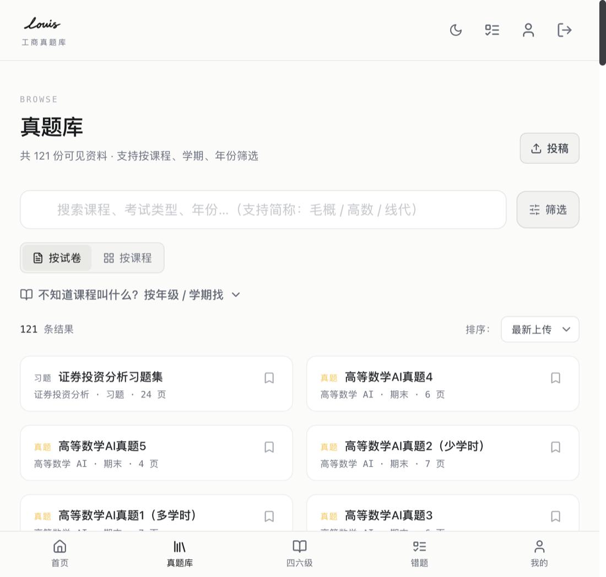
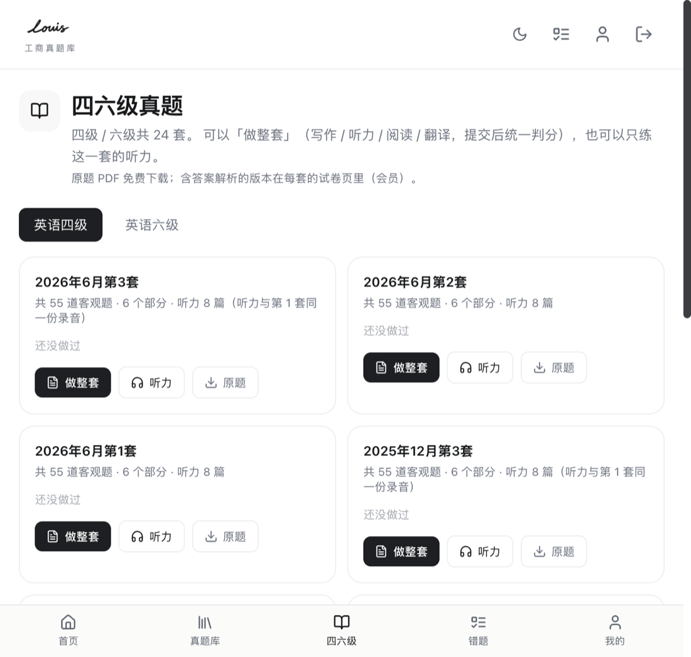

# 重庆工商大学真题库

> CTBU Exam Papers —— 面向重庆工商大学的历年期末考试真题检索与在线阅读系统

<p>
  <a href="https://louisnb.cn"></a>
  
  
  
  
  
  
  
</p>


## 简介

一个**已经真实上线运营**的校园真题平台。收录重庆工商大学历年期末考试真题与四六级真题，支持按课程 / 学期 / 年份检索、在线逐页阅读、错题本、AI 答疑，以及会员与在线支付。

这个仓库是它的完整搭建代码：前端、后端、数据库结构。把整个项目公开出来，一是给同样想做校园资料站的同学一个可参考的实现，二是记录这段从零到上线的过程。

**为什么值得看**：这不是 demo。它处理过一些真实项目才会遇到的问题——支付回调丢失后的对账、并发下单、阅读器的防下载、移动端浏览器支付拉不起 App 时的降级、会员到期与试用规则的叠加。这些问题的解法都写在代码注释里。

## 功能

### 资料检索与阅读

- **121 份真题 · 22 门课程**，按课程 / 考试类型 / 学年学期多维筛选
- 支持简称搜索（「毛概」「高数」「线代」自动匹配全称）
- 在线逐页阅读（扫描件转图片 + 按需加载），标注是否含答案与解析
- 阅读器带**短效签名链接**：图片地址有时效，过期即失效，降低批量抓取的可能
- 错题本、继续阅读（记住上次看到第几页）

### 四六级

- 24 套四级 / 六级真题，支持「做整套」（写作 / 听力 / 阅读 / 翻译，提交后统一判分）
- 单独的听力专项练习
- 原题 PDF 免费下载，含答案解析的版本归会员

### 会员与支付

- 三档定价（单月 / 年度 / 永久），创始会员试用机制
- **微信支付**：微信内走 JSAPI（原地唤起付款面板），浏览器走 Native（扫码 / 长按识别）
- **支付宝**：电脑走电脑网站支付，手机浏览器走手机网站支付
- 支付结果以**服务端异步回调**为准，另有主动查单与轮询兜底
- 订阅到期、试用延长、付费叠加的优先级在数据库里统一裁决

### 其他

- AI 答疑（按题提问，非会员有限次试用）
- 邀请奖励、投稿入口、隐私政策与用户协议
- 深色 / 浅色主题，移动端优先的响应式布局

| 真题库 | 四六级 |
|---|---|
|  |  |

## 技术栈

| 层 | 选型 | 说明 |
|---|---|---|
| 前端 | React 18 + TypeScript + Vite | 纯 SPA，hash 路由，无 UI 框架依赖 |
| 样式 | Tailwind CSS 3 | 主题色走 CSS 变量，深色模式无 `dark:` 分支 |
| 图标 | lucide-react | |
| 后端 | Python 3.12 + 标准库 `http.server` | 单进程多线程，`systemd` 托管，仅监听 127.0.0.1 |
| 数据库 | PostgreSQL 16 | 业务逻辑大量下沉为 SQL 函数 / 触发器 |
| 反代 | Nginx | 同域反代 `/api/*`，静态资源直接出 |
| 支付 | 微信支付 v3 / 支付宝开放平台 | 自行实现签名与验签，不依赖官方 SDK |

后端选择标准库而不是 FastAPI/Flask，是为了**部署极简**：一台 2C2G 的机器、一个 `systemd` 单元、零第三方 Web 依赖就能跑。代价是没有自动的请求校验和路由，所以 `pay_service.py` 里手写了这些。

## 架构

```
┌──────────────┐        ┌───────────────┐        ┌──────────────┐
│  浏览器 / 微信  │◄──────►│     Nginx     │◄──────►│  pay-service │
│  React SPA   │  HTTPS │  同域反代 /api │  HTTP  │  (127.0.0.1) │
└──────────────┘        └───────────────┘        └──────┬───────┘
                               │                        │
                               │ 静态资源                 │ SQL
                               ▼                        ▼
                        /var/www/ctbu            ┌──────────────┐
                        (Vite 构建产物)           │ PostgreSQL 16│
                                                  └──────────────┘
                                                         ▲
                                    微信 / 支付宝 异步回调 ┘
```

几个关键设计：

**前端不持有任何密钥。** 所有支付下单、签名、鉴权都在后端完成，前端只拿回调参数或跳转链接。

**敏感判断放在数据库。** 会员是否有效、订单能否开通、试用怎么叠加，都由 SQL 函数（`grant_membership` / `confirm_payment_auto` / `my_membership`）裁决，后端只负责传递。好处是并发下单不会出现双开，坏处是业务逻辑读起来要跳一层。

**支付结果只认服务端。** 前端从不根据「用户点了支付」就弹成功，必须服务端查到 `paid` 才提示，避免"付了没开通却显示成功"。

## 快速开始

### 环境要求

- Node.js ≥ 18
- Python ≥ 3.10
- PostgreSQL ≥ 14

### 1. 前端

```bash
cd frontend
npm install
npm run dev          # 默认 http://localhost:5173
```

前端所有数据请求走相对路径 `/api/*`，开发时由 Vite 代理到后端。默认代理到 `http://127.0.0.1:8081`，可以用环境变量改：

```bash
# frontend/.env.local
VITE_DEV_API=http://127.0.0.1:8081
```

> 只跑前端也能看到完整界面，但没有数据。想看到真题列表需要把后端和数据库跑起来。

### 2. 数据库

```bash
createdb ctbu
psql -d ctbu -f database/schema.sql
```

`schema.sql` 包含 18 张表、23 个函数与触发器，以及全部索引和 RLS 策略。

> ⚠️ 这个 schema 是从 **Supabase** 迁移过来的，依赖 `auth.users` 表和 `auth.uid()` 函数。你可以直接用 Supabase，或自建一个最小兼容层（一张 `users` 表 + 一个读 session 的 `uid()` 函数）。

还需要初始化一个回调密钥（后端用它校验回调来源）：

```sql
insert into public.app_secrets (key, value)
values ('pay_callback_secret', '改成你自己的随机字符串');
```

### 3. 后端

```bash
cd backend
python3 -m venv .venv && source .venv/bin/activate
pip install -r requirements.txt
```

准备配置文件（路径可用环境变量 `CTBU_CONFIG` 覆盖）：

```bash
mkdir -p /etc/ctbu-pay
cp config.example.json /etc/ctbu-pay/config.json
# 编辑，填入数据库连接与支付商参数
```

启动：

```bash
python3 pay_service.py
# 默认监听 127.0.0.1:8081
```

生产环境用 systemd 托管，Nginx 反代 `/api/` 到该端口即可。

## 配置

### 后端 `config.json`

```jsonc
{
  "db": { "host": "127.0.0.1", "port": 5432, "dbname": "ctbu",
          "user": "ctbu", "password": "***" },

  // 回调签名密钥，必须与数据库 app_secrets 里的一致
  "callback_secret": "***",

  "wechat": {                    // 不给这一段 = 微信支付关闭，其余功能照常
    "appid": "wx...", "mchid": "16...", "app_secret": "***",
    "api_v3_key": "***", "merchant_serial": "***",
    "merchant_key_path": "/etc/ctbu-pay/keys/apiclient_key.pem",
    "notify_url": "https://your-domain.com/api/pay/notify/wechat"
  },

  "alipay": {                    // 同上，缺字段只禁用该通道
    "app_id": "2021...",
    "app_private_key_path": "/etc/ctbu-pay/keys/alipay_app_private.pem",
    "alipay_public_key_path": "/etc/ctbu-pay/keys/alipay_public.pem",
    "notify_url": "https://your-domain.com/api/pay/notify/alipay",
    "return_url": "https://your-domain.com/"
  }
}
```

**配置缺失只会禁用对应通道，不会让整个服务起不来。** 这是踩过坑之后的设计：早期因为微信配置少填一个字段，`raise SystemExit` 触发 systemd 无限重启，整站 502 了四分钟。

### 前端

前端**没有任何密钥**。只需要在需要时配置后端地址：

| 变量 | 用途 | 默认 |
|---|---|---|
| `VITE_DEV_API` | 开发时 Vite 代理目标 | `http://127.0.0.1:8081` |
| `VITE_PAY_API_BASE` | 前后端不同域时的 API 前缀 | 空（同域） |

站点客服 QQ / 微信号在 `frontend/src/lib/policy.ts`，换成你自己的即可。

## 目录结构

```
.
├── frontend/                 React + Vite 单页应用
│   ├── src/
│   │   ├── pages/            页面级组件（首页 / 真题库 / 阅读器 / 会员 …）
│   │   ├── components/       可复用组件（阅读器、支付弹窗、导航 …）
│   │   ├── lib/              API 封装、支付、会员、格式化
│   │   ├── context/          全局状态（登录态、题库、权限）
│   │   └── types/            类型定义
│   ├── public/               静态资源（logo / favicon / 四六级数据）
│   └── docs/                 内容说明
│
├── backend/                  Python 支付与业务服务
│   ├── pay_service.py        主服务：路由、下单、回调、鉴权
│   ├── wechatpay.py          微信支付 v3 签名 / 验签 / 下单 / 查单
│   ├── alipay.py             支付宝 RSA2 签名 / 验签 / 网页支付
│   ├── db.py                 连接池与 rpc 调用
│   ├── ai.py                 AI 答疑
│   ├── captcha.py / sms.py / mailer.py
│   └── concurrency.py        限流与并发保护
│
├── database/
│   └── schema.sql            完整表结构 + 函数 + RLS
│
└── docs/
    ├── ARCHITECTURE.md       设计取舍与踩坑记录
    └── screenshots/          README 配图
```

## 部署

单机部署的最小形态：

```bash
# 前端
cd frontend && npm ci && npm run build
sudo rsync -a --delete dist/ /var/www/ctbu/

# 后端
sudo cp backend/*.py /opt/ctbu-pay/
sudo systemctl restart ctbu-pay
```

Nginx 关键两条：

```nginx
location / { try_files $uri /index.html; }        # SPA 路由
location /api/ { proxy_pass http://127.0.0.1:8081; }
```

> 静态资源目录要**保留历史 `assets/`**（不要 `--delete` 整个目录）。
> 用户浏览器里可能还留着上一版的 `index.html`，它引用的旧哈希文件一旦被删，
> 懒加载会 404，整页白屏。这个项目踩过一次。

## 项目状态

已上线运行，持续迭代中。功能层面基本完整，仍在处理的事：

- 移动端浏览器微信支付只能扫码（微信 H5 支付不对个体工商户开放）
- 试卷内容依赖人工整理，入库流程还未完全自动化

## 贡献

欢迎提 Issue 和 PR。提交前请先看 [CONTRIBUTING.md](CONTRIBUTING.md)。

如果你也想给自己的学校做一套，直接把 `frontend/src/lib/policy.ts`、课程列表和文案换掉就能跑起来，数据结构不用动。

## 许可证

代码以 [MIT License](LICENSE) 开源。

**但请注意**：MIT 只覆盖**代码**。仓库中不包含任何试卷内容、答案、四六级真题——这些内容的著作权属于原权利人（学校、命题教师、出版社），不在本许可证授权范围内。详见下方免责声明。

## 免责声明

- 本项目为个人学习与技术实践作品，与重庆工商大学及任何教育机构**无隶属关系**，不代表其立场。
- 仓库中**不包含**任何试卷原文、答案、听力音频——它们通过 `.gitignore` 排除在外。
- 使用者自行承担部署与运营责任。若用于公开服务，请自行确认所在地区的备案、支付资质与内容合规要求。
- 项目中出现的课程名称、考试名称仅用于描述功能，相关权利归各自所有者。
